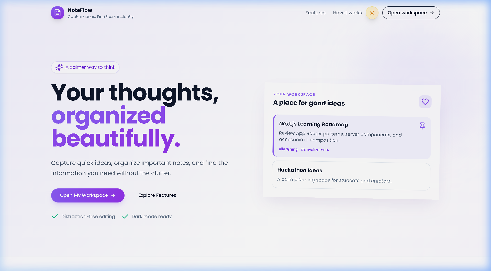
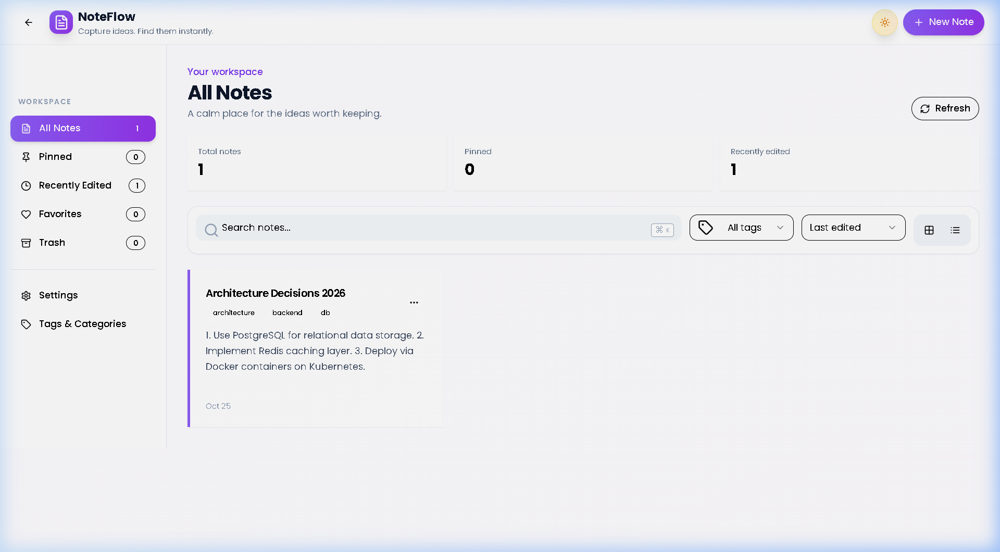
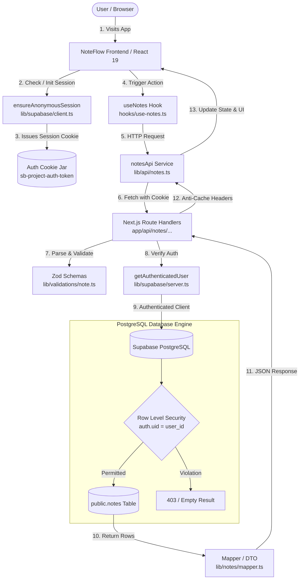

# NoteFlow

<p align="center">
  <strong>Capture ideas. Find them instantly.</strong>
</p>

<p align="center">
  A clean, responsive full-stack notes workspace engineered with Next.js 15, React 19, TypeScript, Tailwind CSS, and Supabase PostgreSQL. Features owner-isolated Row Level Security (RLS) and friction-free Anonymous Authentication.
</p>

<p align="center">
  
  
  
  
  
  
</p>

<p align="center">
  <a href="#features">Features</a> •
  <a href="#screenshots">Screenshots</a> •
  <a href="#technology-stack">Technology Stack</a> •
  <a href="#architecture">Architecture</a> •
  <a href="#database-schema">Database Schema</a> •
  <a href="#rest-api-reference">API Reference</a> •
  <a href="#getting-started">Getting Started</a> •
  <a href="#authentication--security">Security</a> •
  <a href="#testing--verification">Testing</a> •
  <a href="#deployment-guide">Deployment</a>
</p>

---

## Overview

**NoteFlow** is designed for clarity, speed, and privacy. Traditional note apps either rely solely on fragile local storage or enforce cumbersome email registrations before a user can jot down a single thought.

NoteFlow eliminates that friction using **Supabase Anonymous Authentication** combined with **PostgreSQL Row Level Security (RLS)**. As soon as a user visits the application, a verified cryptographic session is issued via secure cookies. Every note created is stored directly in Supabase PostgreSQL, strictly isolated to the user's generated identity.

Next.js 15 App Router serves both the user interface and the backend REST API through typed Route Handlers, removing the need for a separate Express server while delivering sub-millisecond route transitions.

---

## Features

### Workspace Experience
- **Frictionless Note Capture:** Create, edit, and organize notes within an intuitive modal editor with accent color tagging.
- **Full-Note Reading View:** Dedicated reader dialog displaying complete, un-clamped note content, tags, creation timestamps, and last-edited metadata.
- **Grid and List Views:** Switch between responsive multi-column card grids and dense list views with single-click layout controls.
- **Dark Mode Support:** First-class light and dark themes with persistent storage and system preference detection.
- **Responsive Navigation:** Full desktop sidebar with real-time category counters, paired with a collapsible slide-over drawer on mobile viewports.

### Organization & Discovery
- **Instant Keyword Search:** Real-time, case-insensitive search across note titles and content with clean punctuation, quotes, and Unicode emoji handling.
- **Tagging System:** Categorize notes with custom tags. Filter dynamically within the workspace or browse all active tags in the dedicated "Tags & Categories" view.
- **Priority Pinning & Favorites:** Pin important notes to prioritize them at the top of lists and access them through dedicated "Pinned" and "Favorites" sidebar views.
- **Multi-Attribute Sorting:** Sort notes on demand by last-edited timestamp, creation date, or alphabetically by title.

### Safety & Lifecycle
- **Two-Stage Deletion Lifecycle:** Accidental deletions are prevented through a two-stage process:
  1. **Move to Trash:** Soft-deletes notes, removing them from active views while retaining them in the Trash tab.
  2. **Restore:** Return trashed notes to the active workspace at any time.
  3. **Permanent Deletion:** Permanently purges notes from PostgreSQL with an `AlertDialog` confirmation safeguard (enforced on the server with HTTP `409 Conflict` if a note is not already in Trash).

### Full-Stack Architecture & Security
- **Instant Anonymous Identity:** Eliminates registration friction; every visitor immediately receives a private cloud workspace backed by Supabase Auth cookies.
- **Database Row Level Security:** Enforces strict owner isolation directly at the PostgreSQL engine level (`auth.uid() = user_id`). User A can never read, modify, or delete User B's notes.
- **Server Input Validation:** All API endpoints validate request payloads and query parameters using strict Zod schemas.
- **Anti-Caching Protection:** API responses enforce `Cache-Control: private, no-cache, no-store, must-revalidate` so private notes are never cached by intermediate proxies.
- **Idempotent Legacy Migration:** Safely migrates legacy browser `localStorage` notes into the cloud database with per-note progress tracking (`noteflow-migrated-keys`) to prevent duplicates on retry.

---

## Screenshots

### Marketing Landing Page

*Landing page introducing NoteFlow with hero section, feature cards, and quick workspace access.*

### Notes Workspace Dashboard

*Active workspace dashboard showing category counters, search filter, color-coded notes, and sidebar navigation.*

### Visual Capture Guide

To capture and add additional UI states for documentation, save your screenshots to `docs/screenshots/` using the following standard filenames:

| Screenshot Target | Recommended Path | Status |
| :--- | :--- | :---: |
| Marketing Landing Page | `docs/screenshots/landing-page.png` | **Captured** |
| Active Notes Workspace | `docs/screenshots/notes-dashboard.png` | **Captured** |
| Note Creation / Edit Modal | `docs/screenshots/note-editor-modal.png` | Pending Capture |
| Full-Note Reading Modal | `docs/screenshots/full-note-reading.png` | Pending Capture |
| Instant Search & Tags | `docs/screenshots/search-and-filtering.png` | Pending Capture |
| Trash Management View | `docs/screenshots/trash-view.png` | Pending Capture |
| Mobile Viewport Layout | `docs/screenshots/mobile-layout.png` | Pending Capture |
| Dark Mode Theme | `docs/screenshots/dark-mode.png` | Pending Capture |

---

## Technology Stack

| Technology | Role in NoteFlow | Implementation in Project |
| :--- | :--- | :--- |
| **Next.js 15.2.4** | Full-Stack Framework | App Router, Server Components, Route Handlers (`/api/notes`), Edge Middleware |
| **React 19.0.0** | UI Library | Component composition, hooks, concurrent rendering |
| **TypeScript 5** | Language | End-to-end static typing across database rows, API schemas, and client state |
| **Tailwind CSS 3.4** | Styling | Utility-first responsive design, dark mode styling, custom animation tokens |
| **shadcn/ui & Radix UI** | UI Primitives | Accessible `Dialog`, `AlertDialog`, `DropdownMenu`, `Select`, `Card`, `Badge` |
| **Supabase PostgreSQL** | Cloud Database | Relational table storage, GIN tag indexing, automatic `updated_at` trigger |
| **Supabase Auth** | Identity Management | Anonymous user authentication, token issuance, owner-scoped user verification |
| **`@supabase/ssr`** | SSR Cookie Adapter | Synchronizes authentication cookies across Browser, Next.js Middleware, and Route Handlers |
| **Zod 3.24** | Schema Validation | Server-side runtime validation of request bodies and query parameters |
| **Sonner** | Feedback | Rich toast notifications for CRUD actions, validation errors, and network alerts |
| **pnpm** | Package Manager | Fast, deterministic dependency management |

> **Note on Architecture:** NoteFlow is not a MERN stack application. Next.js 15 provides both the frontend UI and the REST API Route Handlers in a unified codebase, eliminating the need for a standalone Express.js server while maintaining clean architectural separation.

---

## Architecture

### Request & Authentication Flow

The following sequence demonstrates how requests flow from the user interface through the typed API client, server Route Handlers, and Supabase PostgreSQL with RLS:



### Repository Structure

```
noteflow/
├── app/
│   ├── api/
│   │   └── notes/
│   │       ├── route.ts                 # GET /api/notes (list/filter) & POST /api/notes (create)
│   │       └── [id]/
│   │           └── route.ts             # GET, PATCH, DELETE /api/notes/[id]
│   ├── globals.css                      # Design tokens, theme CSS variables, Tailwind directives
│   ├── layout.tsx                       # Root layout mounting Toaster and font definitions
│   └── page.tsx                         # Landing page and AppWrapper entry point
├── components/
│   ├── ui/                              # Radix-based accessible UI primitives (dialog, card, etc.)
│   ├── sidebar-navigation.tsx           # Category navigation tabs and badge counters
│   ├── theme-provider.tsx               # Light/dark mode state management
│   └── website-components.tsx           # Marketing landing page components
├── docs/
│   └── screenshots/                     # Genuine application screenshots
├── hooks/
│   └── use-notes.ts                     # Custom React hook for notes state, actions, and migration
├── lib/
│   ├── api/
│   │   ├── notes.ts                     # Typed API client targeting same-origin Route Handlers
│   │   └── response.ts                  # Standardized JSON response helpers (apiSuccess, apiError)
│   ├── notes/
│   │   └── mapper.ts                    # DTO converters between database snake_case and client camelCase
│   ├── supabase/
│   │   ├── client.ts                    # Browser client & anonymous authentication singleton
│   │   ├── middleware.ts                # Session token refresh helper for Next.js Middleware
│   │   ├── server.ts                    # Cookie-aware server client & getAuthenticatedUser
│   │   └── types.ts                     # TypeScript database definitions
│   ├── validations/
│   │   └── note.ts                      # Zod validation schemas for requests and query parameters
│   └── utils.ts                         # Classname merging helper (cn)
├── middleware.ts                        # Edge middleware intercepting requests to refresh auth cookies
├── supabase/
│   └── migrations/
│       └── 0001_create_notes.sql        # Database table, performance indexes, triggers, and RLS
├── .env.example                         # Environment variable template with safe placeholders
├── .gitignore                           # Git exclusion rules protecting .env.local and builds
├── package.json                         # Project scripts and dependency definitions
├── tailwind.config.ts                   # Tailwind theme configuration
└── tsconfig.json                        # TypeScript strict compiler configuration
```

---

## Database Schema

NoteFlow's schema is defined in [`supabase/migrations/0001_create_notes.sql`](supabase/migrations/0001_create_notes.sql).

### `public.notes` Table

| Column | Type | Constraints / Default | Description |
| :--- | :--- | :--- | :--- |
| `id` | `UUID` | `PRIMARY KEY DEFAULT gen_random_uuid()` | Unique note identifier |
| `user_id` | `UUID` | `NOT NULL REFERENCES auth.users(id) ON DELETE CASCADE` | Owner ID linked to Supabase Auth |
| `title` | `TEXT` | `NOT NULL CHECK (char_length(trim(title)) > 0)` | Title (non-empty, up to 200 chars via Zod) |
| `content` | `TEXT` | `NOT NULL DEFAULT ''` | Note body (supports multiline text) |
| `tags` | `TEXT[]` | `NOT NULL DEFAULT '{}'::TEXT[]` | Lowercase category tags array |
| `is_pinned` | `BOOLEAN` | `NOT NULL DEFAULT FALSE` | Pinned priority flag |
| `is_favorite` | `BOOLEAN` | `NOT NULL DEFAULT FALSE` | Favorite flag |
| `is_trashed` | `BOOLEAN` | `NOT NULL DEFAULT FALSE` | Soft-delete trash flag |
| `color` | `TEXT` | `NOT NULL DEFAULT 'violet' CHECK (color IN (...))` | Accent color: `violet`, `amber`, `blue`, `emerald`, `rose`, `slate` |
| `created_at` | `TIMESTAMPTZ`| `NOT NULL DEFAULT now()` | UTC creation timestamp |
| `updated_at` | `TIMESTAMPTZ`| `NOT NULL DEFAULT now()` | UTC modification timestamp |

### Indexes & Performance
- `idx_notes_owner_lookup` on `(user_id, is_trashed, is_pinned DESC, updated_at DESC)`: Optimizes filtered queries for views (`all`, `pinned`, `recent`, `trash`).
- `idx_notes_owner_updated_at` on `(user_id, updated_at DESC)`: Speeds up timestamp sorting.
- `idx_notes_owner_tags` USING GIN `(tags)`: GIN index for high-speed tag membership lookups (`tags @> ARRAY['tag']`).

### Automatic Timestamp Trigger
A PL/pgSQL function and trigger automatically update `updated_at` on any note modification:
```sql
CREATE OR REPLACE FUNCTION public.handle_updated_at()
RETURNS TRIGGER AS $$
BEGIN
  NEW.updated_at = now();
  RETURN NEW;
END;
$$ LANGUAGE plpgsql;

CREATE TRIGGER on_note_updated
  BEFORE UPDATE ON public.notes
  FOR EACH ROW
  EXECUTE FUNCTION public.handle_updated_at();
```

### Row Level Security (RLS) Policies
Public and anonymous direct access is revoked. Full access is granted strictly to authenticated roles governed by owner-matching policies:

```sql
ALTER TABLE public.notes ENABLE ROW LEVEL SECURITY;

REVOKE ALL ON TABLE public.notes FROM PUBLIC;
REVOKE ALL ON TABLE public.notes FROM anon;
GRANT SELECT, INSERT, UPDATE, DELETE ON TABLE public.notes TO authenticated;

-- Policies enforce that users can only interact with their own records
CREATE POLICY "Users can select their own notes"
  ON public.notes FOR SELECT TO authenticated
  USING (auth.uid() = user_id);

CREATE POLICY "Users can insert their own notes"
  ON public.notes FOR INSERT TO authenticated
  WITH CHECK (auth.uid() = user_id);

CREATE POLICY "Users can update their own notes"
  ON public.notes FOR UPDATE TO authenticated
  USING (auth.uid() = user_id)
  WITH CHECK (auth.uid() = user_id);

CREATE POLICY "Users can delete their own notes"
  ON public.notes FOR DELETE TO authenticated
  USING (auth.uid() = user_id);
```

---

## REST API Reference

All requests and responses use JSON format. Every route verifies the user's cookie-based session; unauthenticated requests return `401 Unauthorized`.

| Method | Endpoint | Description | Status Codes |
| :--- | :--- | :--- | :--- |
| **GET** | `/api/notes` | List and filter notes for the authenticated user | `200`, `400`, `401`, `500` |
| **POST** | `/api/notes` | Create a new note | `201`, `400`, `401`, `500` |
| **GET** | `/api/notes/[id]` | Retrieve a single note by UUID | `200`, `400`, `401`, `404`, `500` |
| **PATCH** | `/api/notes/[id]` | Update one or more fields of an existing note | `200`, `400`, `401`, `404`, `500` |
| **DELETE** | `/api/notes/[id]` | Permanently delete a note (must be in Trash) | `204`, `400`, `401`, `404`, `409`, `500` |

### 1. List / Filter Notes
`GET /api/notes`

**Query Parameters:**
- `view` (string, optional): `all` (default), `pinned`, `recent`, `favorites`, `trash`
- `tag` (string, optional): Filter by exact tag name (e.g. `architecture`)
- `search` (string, optional): Case-insensitive search string matching title or content
- `sort` (string, optional): `edited` (default), `created`, `title`

**Success Response (200 OK):**
```json
{
  "notes": [
    {
      "id": "8b0b076f-9bb4-4915-9a73-9dc166fcf2d3",
      "title": "System Architecture Roadmap",
      "content": "Next.js 15 App Router with Supabase PostgreSQL and Row Level Security.",
      "tags": ["architecture", "backend"],
      "color": "violet",
      "pinned": true,
      "favorite": false,
      "trashed": false,
      "createdAt": "2026-10-25T17:16:34.000Z",
      "updatedAt": "2026-10-25T17:16:34.000Z"
    }
  ]
}
```

### 2. Create Note
`POST /api/notes`

**Request Body:**
```json
{
  "title": "Weekly Planning",
  "content": "Finalize documentation, run build checks, and verify deployment checklist.",
  "tags": ["planning", "work"],
  "color": "emerald",
  "pinned": false,
  "favorite": false
}
```

**Success Response (201 Created):**
```json
{
  "note": {
    "id": "cefeb15e-ffae-468f-8507-de67bb1dfb17",
    "title": "Weekly Planning",
    "content": "Finalize documentation, run build checks, and verify deployment checklist.",
    "tags": ["planning", "work"],
    "color": "emerald",
    "pinned": false,
    "favorite": false,
    "trashed": false,
    "createdAt": "2026-10-25T17:14:02.000Z",
    "updatedAt": "2026-10-25T17:14:02.000Z"
  }
}
```

**Validation Error (400 Bad Request):**
```json
{
  "error": {
    "code": "VALIDATION_ERROR",
    "message": "Title cannot be blank"
  }
}
```

### 3. Update Note
`PATCH /api/notes/[id]`

**Request Body (Partial Update):**
```json
{
  "title": "Weekly Planning - Updated",
  "pinned": true
}
```

**Soft Delete to Trash:**
```json
{
  "trashed": true
}
```

**Success Response (200 OK):**
```json
{
  "note": {
    "id": "cefeb15e-ffae-468f-8507-de67bb1dfb17",
    "title": "Weekly Planning - Updated",
    "pinned": true,
    ...
  }
}
```

### 4. Permanently Delete Note
`DELETE /api/notes/[id]`

- If the note is **not** in Trash (`is_trashed = false`), the server rejects the request with **`409 Conflict`**:
  ```json
  {
    "error": {
      "code": "CONFLICT",
      "message": "Note must be moved to Trash before it can be permanently deleted"
    }
  }
  ```
- If the note is in Trash (`is_trashed = true`), the note is permanently purged and the server returns **`204 No Content`** (empty body).

---

## Getting Started

### Prerequisites

- **Node.js:** `v18.18.0` or higher (`v20+` or `v24+` recommended)
- **Package Manager:** `pnpm` (`npm install -g pnpm`)
- **Supabase Account:** Free account at [supabase.com](https://supabase.com/)

---

### Step-by-Step Local Setup

#### 1. Clone the Repository
```bash
git clone <your-repository-url>
cd noteflow
```

#### 2. Install Dependencies
```bash
pnpm install
```

#### 3. Create a Supabase Project
1. Log in to your [Supabase Dashboard](https://supabase.com/dashboard) and click **"New Project"**.
2. Choose a project name, database password, and region.
3. Wait for database provisioning to complete.

#### 4. Enable Anonymous Authentication
1. In your Supabase dashboard, navigate to **Authentication -> Providers**.
2. Click on the **Email / Auth Providers** or scroll to **Anonymous Sign-ins**.
3. Toggle **"Enable Anonymous Sign-ins"** to **ON**.
4. Click **Save**.

#### 5. Apply Database Migration
1. In your Supabase project, navigate to the **SQL Editor** tab.
2. Open [`supabase/migrations/0001_create_notes.sql`](supabase/migrations/0001_create_notes.sql) in this repository.
3. Copy its entire content, paste it into the Supabase SQL Editor, and click **Run**.
4. Confirm the `public.notes` table, triggers, and RLS policies are created successfully.

#### 6. Configure Environment Variables
Copy the `.env.example` template to `.env.local`:

```bash
# On Linux / macOS / Git Bash:
cp .env.example .env.local

# On Windows PowerShell:
Copy-Item .env.example .env.local
```

Open `.env.local` and enter your Supabase project credentials (found under **Project Settings -> API**):

```env
NEXT_PUBLIC_SUPABASE_URL=https://<your-project-id>.supabase.co
NEXT_PUBLIC_SUPABASE_PUBLISHABLE_KEY=sb_publishable_<your-publishable-key>
```

> **Security Note:** Never commit `.env.local` to Git. The `.gitignore` file excludes all `.env*` files except `.env.example`.

#### 7. Start the Development Server
```bash
pnpm dev
```
Open [http://localhost:3000](http://localhost:3000) in your browser.

#### 8. Verify Compilation & Production Build
```bash
# Run TypeScript compilation check
pnpm exec tsc --noEmit

# Test production build bundle
pnpm build

# Start local production server
pnpm start
```

---

## Authentication & Security

### Anonymous Sessions
NoteFlow uses Supabase Anonymous Authentication to provide an instant, frictionless experience without requiring an upfront sign-up form.
- Upon loading the application, `ensureAnonymousSession()` in `lib/supabase/client.ts` verifies if an active session exists. If not, it requests an anonymous JWT token from Supabase Auth.
- The session is stored in an HTTP-safe cookie (`sb-<project-ref>-auth-token`).
- `middleware.ts` runs on incoming requests to refresh tokens that are close to expiration.

### Multi-Tenant Isolation
- Every database query in the Next.js Route Handlers executes through a Supabase client that provides the caller's JWT.
- PostgreSQL Row Level Security enforces `auth.uid() = user_id`.
- Even if a malicious actor guesses or crafts another user's note UUID, queries return `404 Not Found` or empty results, making cross-user snooping or modification impossible.

### Important Session Lifespan Considerations
- **Cookie Dependency:** Anonymous sessions are tied to the browser's cookie storage. If a user clears their browser cookies, uses incognito/private mode, or switches browsers, a new anonymous identity is generated.
- **Account Linking (Future Enhancement):** Supabase supports linking an email or OAuth account (e.g. GitHub, Google) to an existing anonymous account, allowing users to preserve their notes permanently across devices.

### Production Abuse Prevention (CAPTCHA)
For public production deployments with anonymous authentication enabled, Supabase strongly recommends enabling **CAPTCHA protection** (such as Cloudflare Turnstile or hCaptcha) under **Authentication -> Attack Protection** in the Supabase dashboard to prevent bot abuse from exhausting database connection limits.

---

## Testing & Verification

NoteFlow's codebase is validated using strict static typing, production bundle analysis, and end-to-end integration test suites:

### 1. Static Type Checking
```bash
pnpm exec tsc --noEmit
```
*Ensures zero type diagnostics across all API routes, schemas, hooks, and React 19 components.*

### 2. Production Build Check
```bash
pnpm build
```
*Verifies Next.js App Router tree optimization, prerendering of static pages, and compilation of dynamic API routes.*

### 3. Formatting & Whitespace Verification
```bash
git diff --check
```
*Validates that no trailing whitespace or unresolved merge markers exist in the working tree.*

### 4. Manual QA Verification Checklist

| Test Flow | Expected Behavior | Status |
| :--- | :--- | :---: |
| **First Visit & Auth** | Anonymous session is created automatically; notes list loads without mock seed data | Verified |
| **Note Creation** | Note modal opens with solid contrast; creates note with title, content, tags, and color | Verified |
| **Persistence Across Reload** | Hard refresh retains created notes and sidebar category counters | Verified |
| **Full-Note Reader** | Clicking note card opens un-clamped reading modal with full body and timestamps | Verified |
| **Note Editing** | Title and content edits update immediately in UI and persist to PostgreSQL | Verified |
| **Validation Enforcement** | Submitting a blank title triggers Sonner warning toast and prevents save | Verified |
| **Instant Search** | Search input filters instantly by title and content; handles Unicode emojis (🚀) | Verified |
| **Tag Navigation** | Clicking tags filters workspace; "Tags & Categories" view displays active tag pills | Verified |
| **Pin & Favorites** | Toggling pin/star updates note badges and moves notes into dedicated sidebar tabs | Verified |
| **Trash & Restore** | Trashed notes disappear from active lists; restore returns them to workspace | Verified |
| **Permanent Deletion** | Confirmation dialog appears; confirms permanent purge from database (204 No Content) | Verified |
| **Two-User Isolation** | Independent browser sessions cannot view, edit, or delete another user's notes | Verified |

---

## Deployment Guide

### Deploying to Vercel

NoteFlow is configured for one-click deployment on [Vercel](https://vercel.com/):

1. **Push to GitHub:** Push your code to a private or public GitHub repository.
2. **Import to Vercel:**
   - Log in to your Vercel Dashboard.
   - Click **"Add New Project"** and import your NoteFlow repository.
3. **Configure Project Settings:**
   - **Framework Preset:** Next.js
   - **Root Directory:** `./`
   - **Build Command:** `next build` (or `pnpm build`)
   - **Output Directory:** `.next`
   - **Install Command:** `pnpm install`
4. **Set Environment Variables:**
   Add the following variables in the Vercel project settings:
   - `NEXT_PUBLIC_SUPABASE_URL`: Your Supabase project URL (`https://<project-ref>.supabase.co`)
   - `NEXT_PUBLIC_SUPABASE_PUBLISHABLE_KEY`: Your Supabase publishable API key
5. **Configure Allowed Origins:**
   In your Supabase Dashboard, go to **Authentication -> URL Configuration** and add your production Vercel URL (e.g. `https://your-app.vercel.app`) to the **Redirect URLs** list.
6. **Deploy:** Click **"Deploy"**. Vercel will build the production bundle and assign your live URL.

---

## Project Status & Contribution

### Status
NoteFlow was developed as **Task 1: Notes Application** for the **CodeNova Full Stack Development Batch 01 Internship**. The frontend, REST API, Supabase persistence layer, anonymous authentication, and automated QA validations are fully implemented and verified.

### Development Workflow
1. Fork or branch from `main`:
   ```bash
   git checkout -b feature/your-feature-name
   ```
2. Commit your changes using descriptive commit messages:
   ```bash
   git commit -m "feat: add your feature description"
   ```
3. Verify type safety and production build before submitting:
   ```bash
   pnpm exec tsc --noEmit
   pnpm build
   ```

---

<p align="center">
  Crafted with care for the <strong>CodeNova Full Stack Development Internship</strong>.
</p>
